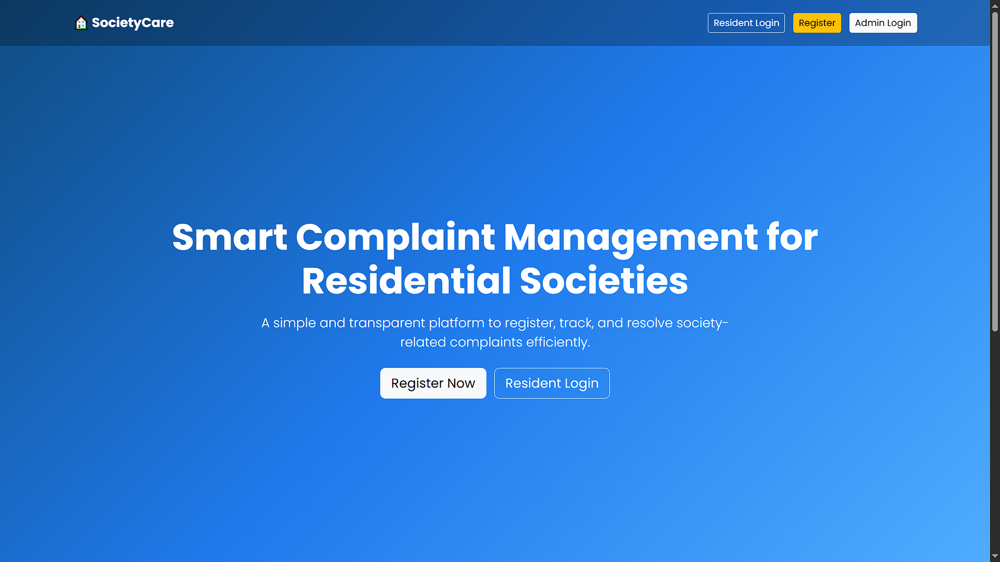
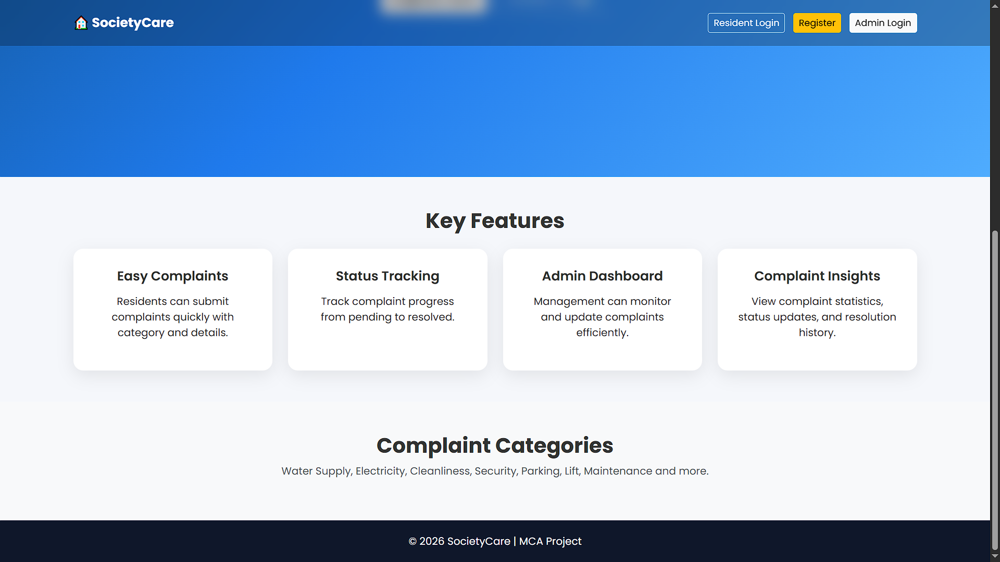
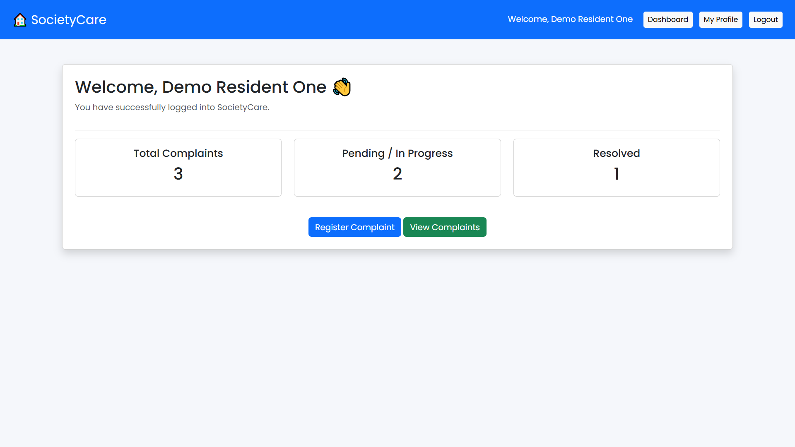
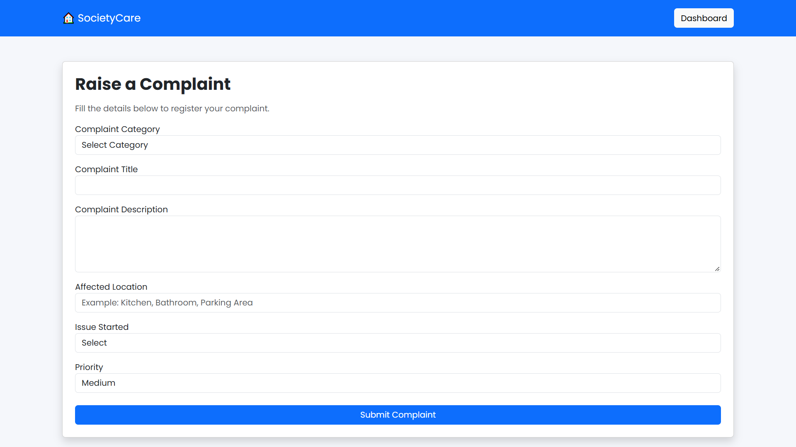
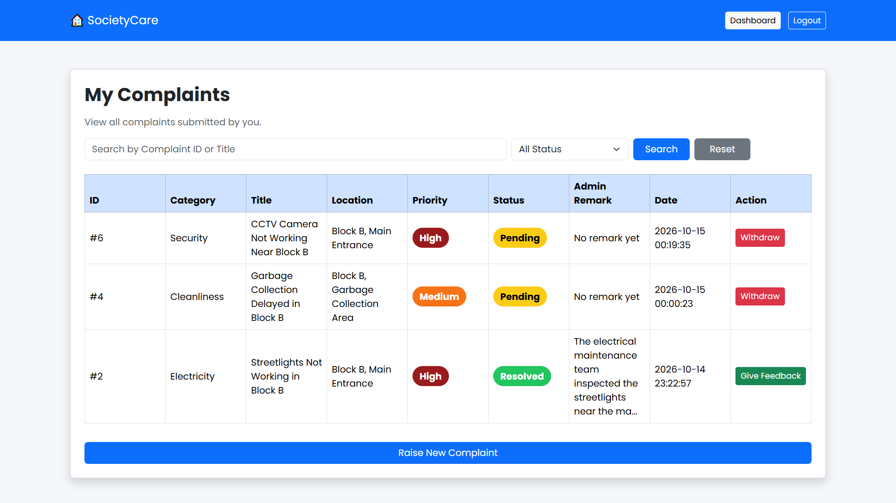
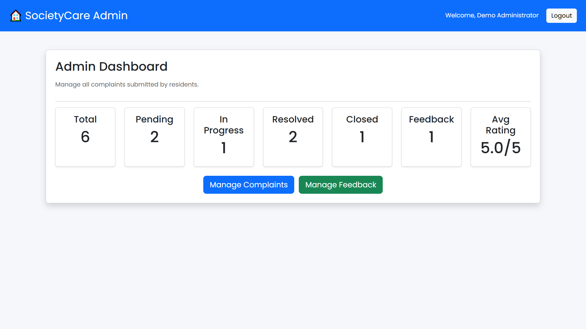
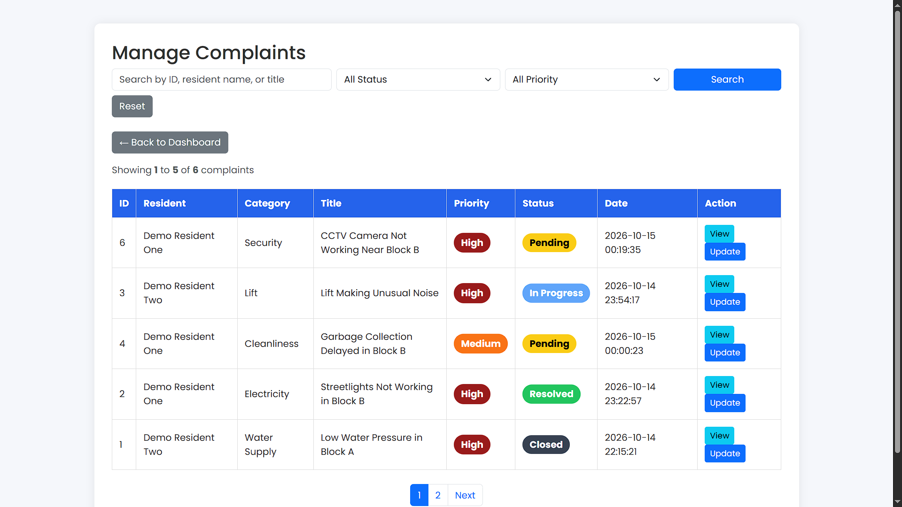
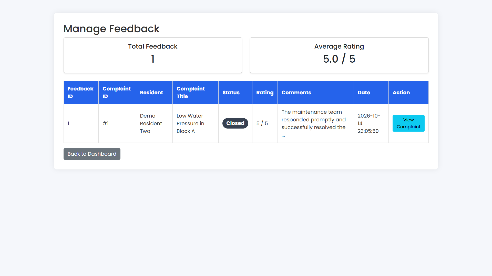

# SocietyCare — Society Complaint Management System

SocietyCare is a PHP and MySQL web application for managing maintenance and service complaints in residential societies. Residents can submit and track complaints, while administrators can review requests, update their status, and record resolution remarks.

This project was developed as part of an MCA Full Stack Development programme and subsequently refined as a **local demonstration and software portfolio project**.

## Features

### Resident

- Register and sign in to a resident account.
- View a dashboard with complaint statistics.
- Submit complaints with a category, description, location, issue-started timeframe, and priority.
- View and filter personal complaints, including their current status and update history.
- Withdraw complaints when permitted by the application.
- Submit feedback on eligible complaints and view previously submitted feedback.
- Update profile details and change the account password.

### Administrator

- Sign in through a separate administrator login.
- View complaint counts by status, feedback totals, and average feedback rating.
- Review, search, and filter residents' complaints.
- Update complaint status and add remarks; changes are recorded in complaint history.
- Review resident feedback and complaint details.

**Complaint statuses:** Pending, In Progress, Resolved, Closed.

## Technology Stack

| Layer | Technologies |
| --- | --- |
| Backend | PHP (procedural), MySQL / MariaDB |
| Frontend | HTML5, CSS3, Bootstrap 5 |
| Local environment | XAMPP, Apache, phpMyAdmin |
| Development | Visual Studio Code, Git / GitHub |

## Project Structure

```text
SocietyCare-Portfolio/
├── admin/                         # Administrator pages
├── resident/                      # Resident pages
├── assets/
│   └── css/
│       └── style.css              # Custom stylesheet
├── config/
│   └── database.example.php       # Local database settings template
├── database/
│   └── societycare_portfolio_demo.sql
├── docs/
│   └── screenshots/                 # Reviewed demo screenshots
├── index.php                      # Homepage
├── login.php                      # Resident login
├── logout.php                     # Session logout
├── register.php                   # Resident registration
├── .gitignore
└── README.md
```

The `config/database.php` file is intentionally excluded from Git. Create it locally from the example file before running the application.

## Local Installation (XAMPP)

**Requirements:** XAMPP or an equivalent local PHP, Apache, and MySQL/MariaDB environment; phpMyAdmin is recommended for importing the sample database.

1. **Get the source code.** Clone this repository or download its ZIP, and place the project folder inside your XAMPP `htdocs` directory (for example, `C:\xampp\htdocs\SocietyCare-Portfolio`).
2. **Start Apache and MySQL** from the XAMPP Control Panel.
3. **Create an empty database** named `societycare_portfolio_demo` in phpMyAdmin. The included SQL file creates the tables, but does not create the database itself.
4. **Import the sample SQL file.** Select `societycare_portfolio_demo` in phpMyAdmin, open **Import**, and choose `database/societycare_portfolio_demo.sql`.
5. **Create your local configuration.** Copy `config/database.example.php` to `config/database.php` (keep the example file). Edit the copy to match your local MySQL connection settings. The example uses `localhost`, user `root`, and a blank password as common **local XAMPP defaults only**.
6. **Open the application** in a browser at `http://localhost/SocietyCare-Portfolio/`, adjusting the URL if you used a different folder name.

Do not import the SQL file into a database containing important data; use a new, empty database. Do not publish your local `config/database.php`.

## Demonstration Accounts

The sample SQL file includes these **fictional accounts for local testing only**:

| Role | Email | Password |
| --- | --- | --- |
| Administrator | `admin@example.com` | `SocietyDemo2026!` |
| Resident One | `resident1@example.com` | `SocietyDemo2026!` |
| Resident Two | `resident2@example.com` | `SocietyDemo2026!` |

Administrator login: `http://localhost/SocietyCare-Portfolio/admin/login.php`  
Resident login: `http://localhost/SocietyCare-Portfolio/login.php`

**Security notice:** These passwords are publicly documented demonstration credentials. Use them only in an isolated local development environment; never deploy the sample accounts or these credentials to a live service.

The seed dataset contains two residents, six complaints, fourteen complaint-history entries, one feedback entry, and eight complaint categories. It demonstrates different complaint statuses and feedback handling.

## Database Overview

The schema contains six tables: `admins`, `residents`, `categories`, `complaints`, `complaint_history`, and `feedback`.

- Complaints reference a resident and a category.
- Complaint history stores status changes and remarks.
- Feedback references both a resident and a complaint.
- A unique index on `feedback.complaint_id` prevents multiple feedback records for the same complaint.

The provided SQL dump was tested by importing it into a separate empty database and verifying the six table counts and the feedback unique index.

## Security and Testing Notes

The portfolio version includes parameterized queries for user-supplied values in reviewed data-changing modules, password hashing and verification, session-based access checks, HTML output escaping, and CSRF protection on reviewed sensitive forms. Several form handlers use Post/Redirect/Get to avoid accidental resubmission; complaint updates use transactions to keep status and history changes together.

Testing included authentication and access restrictions, resident and admin dashboards, complaint visibility and management, feedback validation, selected CSRF and refresh scenarios, and a fresh database import. **This is not a production security audit.** Some successful post-patch workflows (including password change, registration, and complaint update) were not independently retested end to end with temporary accounts.

**Scope and limitations:** This is a local educational/portfolio application, not a production residential-management service. It does not implement login rate limiting, email verification/OTP, or production deployment hardening. Image uploads are not part of the current complaint-submission interface.

## Screenshots

These screenshots were captured using fictional demonstration accounts and sample complaints. Click an image in GitHub to view it at full size.

### Homepage



### Homepage Features



### Resident Dashboard



### Raise a Complaint



### My Complaints



### Administrator Dashboard



### Manage Complaints



### Manage Feedback



## Author

**Ashish Kumar Singh**  
Master of Computer Applications (MCA)  
Full Stack Development  
Lovely Professional University (Online)

**GitHub:** [ashishks-dev](https://github.com/ashishks-dev)
